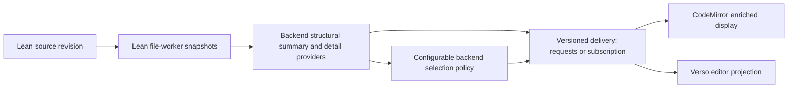

# Enriched display: initial design exploration

Status: proposal, 2026-11-06. The [use cases](enriched-display-use-cases.md) govern
the design. No wire API, upstream Lean feature, mathematical translator, or new
shared package described here is implemented by this document.

## Information flow

The source remains the editable document. The backend derives compact summaries
from actual worker snapshots. The frontend owns layout, expansion, selection,
and rendering. It never reparses Lean to manufacture authoritative boundaries.

The initial display should add theorem/documentation views and structural
folding to the existing source editor. A source reveal operation provides the
editing path. Rich mathematical editing with automatic TeX-to-Lean conversion
is outside this first design; KaTeX views are read-only projections.

## Backend extraction and its limits

In the locally inspected Lean 4.34.1 sources, a command snapshot exposes syntax,
command state, an environment, and access to elaboration information. These are
inputs for an extractor, not an already-defined theorem/documentation display
API. Establish reliable declaration ownership, ranges, documentation association,
and statement/proof boundaries with a focused backend feasibility experiment.

One command can produce multiple declarations; macros and elaborators can
generate declarations without independent source ranges. Namespace/section
context, implicit parameters, local notation, and generated helpers require
explicit handling. A declaration's global name or an array index alone cannot
serve as stable identity across edits. Preserve unknown cases as source regions.

Do not force incomplete elaboration tasks merely to populate a document outline.
The inspected `Snapshot.infoTree` implementation includes a blocking warning;
the experiment must identify nonblocking access and bounded waits for the data
actually needed. Outline extraction and expensive semantic/detail queries should
have independent readiness and cancellation.

Verso's current backend demonstrates a useful existing path: capture `readDoc`,
walk completed `cmdSnaps` with a bounded cancellable wait, summarize actual
syntax, validate original source, and return explicit partial coverage. Its
`root.children` is a summary rather than a complete editable CST. Its current
block IDs derive from traversal indices and should not be assumed stable across
edits. The local projects pin different Lean releases (4.34.1 and 4.36.0-rc1),
so a common contract must not imply binary or internal-API compatibility.

## Candidate information contract

These are required concepts, not finalized field names:

| Information | Purpose |
| --- | --- |
| Document URI, open-session/server generation, source revision and source equivalence | Reject results for the wrong text, tab, reopened file, or server |
| Summary identity and analysis sequence within that revision | Order partial-to-complete updates for unchanged source |
| Explicit coordinate encoding and original-source ranges | Place displays correctly across CRLF, Unicode and transport normalization |
| Coverage and completion state | Distinguish pending, unsupported, failed and absent structure |
| Region identity, kind, parent/context and source anchors | Navigate declarations, documentation, proofs, sections and fallback regions |
| Independent structure, statement and checking availability | Avoid equating a rendered statement with a successfully checked proof |
| Capability/provider identifiers | Discover supported detail formats and selection policies |
| Policy identity/configuration and selection reasons | Explain and reproduce the chosen summary |
| Bounded detail references tied to a summary revision | Load documentation, mathematical statements or dependencies on expansion |

Use original-source UTF-16 ranges at the editor boundary, consistent with the
existing Verso transport. Bind references to the captured revision and reject
expired ones; never retain worker snapshots indefinitely just to keep UI handles
alive. Details may be unavailable without invalidating the outline.

Request IDs correlate responses. Document revisions establish source identity.
Analysis sequences order successive updates for the same revision. Selection
configuration identifies a view policy. Keep these meanings distinct.

## Pull and broadcast

| Mechanism | Useful property | Requirement |
| --- | --- | --- |
| Pull current summary or region details | Explicit demand, cancellation, lazy expansion; matches the existing Verso approach | A later pull must be possible when analysis advances without a source edit |
| Broadcast/subscribed summaries | Updates follow worker progress naturally | Subscription ownership, bounded queues/coalescing, per-revision update ordering and reconnection |
| Notify availability, then pull | Small notifications with demand-driven materialization | Both an availability signal and a request contract |

Start the feasibility experiment with pull requests over captured snapshots.
Keep delivery independent of the summary data so a subscription or availability
notification can be added after evaluating upstream support. Do not prescribe
method names or send unsolicited whole-document trees on every worker update.
If the first prototype uses refresh polling, keep it bounded and cancellable.
An immutable captured document cannot be polled into becoming a future revision.

On an edit, invalidate affected displays and cancel obsolete work immediately.
A stale response cannot regain authority merely because its ranges can be mapped
through the edit. The simplest initial rule is whole-summary invalidation, with
source fallback until matching information returns. Later incremental reuse
requires a demonstrated correspondence contract.

## Configurable backend summarization

Selection runs against the structural summary and optional semantic information.
It does not require replaying elaboration. Advertised policy providers accept
validated configuration scoped to a request or reader session, with optional
project defaults. They must not mutate global selection settings shared by tabs.

Initial policy families are annotations/pins, structural filters, and dependency
or relevance selection. Each policy reports its identity, effective configuration,
selection reasons, and unavailable inputs. Unsupported options fail explicitly.
Dependency policies specify whether they inspect statements, proofs, or another
relation; deterministic selection should be reproducible from the same inputs.

Return enough structure or expansion handles to discover omitted material.
Backend-selected core nodes and reader expansion are separate state. Expanding
a helper does not promote it to core; pinning it may change the next policy
request. An error or search result can temporarily reveal a hidden region.
Selection failures leave source and available structure usable.

## Mathematical statements and documentation

KaTeX renders supplied TeX. Producing faithful TeX from Lean requires a separate
provider with an explicit supported subset and presentation policy. Start from
snapshot-associated syntax and elaborated declaration data, evaluate which
representation preserves user notation and binder context, and retain a Lean
text fallback. Do not translate by regular-expression substitutions over source.
Neither syntax nor a bare elaborated expression alone solves all presentation
questions; custom notation and implicit/contextual arguments need experiments.

A detail response should identify its declaration, source revision, format,
provider, and availability. KaTeX input is presentation data, not new proof
authority. Keep full Lean text accessible alongside any elided formal detail.
Unsupported constructs, pending elaboration, and render errors have distinct
fallbacks. The rendered statement never conceals an incomplete proof status.

Documentation needs a format-aware provider and source anchors. Render the
supported Lean documentation format or structured Verso content through the
appropriate frontend adapter. Preserve project-specific roles and directives
as explicit fallback when no renderer is available.

Use the host's content-safety boundary for documentation and KaTeX options:
restrict trusted commands, bound expansion, keep unrelated documents' macro
state separate, and display renderer errors as text. KaTeX's
[API](https://katex.org/docs/api) documents TeX input and macro state; its
[security guidance](https://katex.org/docs/security) describes the relevant
limits and trust options.

## Frontend projection and identity

Keep source in the existing CodeMirror document. Implement displays and folds
as view state derived from accepted summaries; expansion preferences are separate
from document edits and undo. Source reveal, keyboard navigation, search and
diagnostic navigation must open the relevant regions. No current selection may
be hidden by a newly applied summary. Measure decoration/widget churn and scroll
stability before choosing fine-grained incremental updates.

Use revision-local region identities first. Restoring expansion across revisions
requires conservative correspondence using declaration identity and enclosing
context, with source anchors where valid. Deletion, renaming, duplicate/local
names and macro-generated declarations can make correspondence ambiguous; reset
the affected view preference rather than attaching it to unrelated content.

## Shared boundary with verso-mirror

Potential shared concepts are source identity, ranges, coverage, update ordering,
capability negotiation, detail lifetime and selection configuration. Lean
declaration payloads and Verso block payloads retain their own schemas. Neither
the generic shell package nor either frontend should import Lean worker internals.

Use the current Verso implementation as evidence, then exercise a declaration
consumer and a Verso consumer before extracting a package. Schema versioning and
capability negotiation must account for independent toolchain pins. Migrating
Verso's existing endpoint, broadcasting structure, or moving diagnostics to the
normal LSP channel are separate coordinated changes.

## Design sequence and upstream discussion

1. Agree the use-case fixture and summary policy configuration surface.
2. Probe actual snapshots for declaration ownership, precise statement/proof/doc
   ranges and partial progress. Record unsupported forms and toolchain differences.
3. Sketch the minimal information envelope with a Verso consumer example; decide
   the initial pull/update strategy from observed upstream capabilities.
4. Build one vertical slice: current summary, inline documentation, one supported
   mathematical statement form, configurable selection, and source expansion.
5. Exercise edits, undo, stale replies, policy changes, errors in collapsed
   regions, restart and teardown through the real backend and production bundle.

For Marc and the Lean/Verso maintainers, discuss a supported snapshot-summary
surface, progress/invalidation notifications, access to declaration/documentation
metadata, and versioning/lifetime guarantees. Infoview disposal remains useful
parallel integration work; enriched display does not require a new VS Code host
or wait for the infoview ownership API to begin its design.

## Evidence used for this proposal

- The checked-in `lean-toolchain` and installed Lean 4.34.1 sources:
  `Lean/Server/Snapshots.lean` and `Lean/Server/Requests.lean`.
- The sibling checkout's `Bridge/WorkerStructure.lean`, `Bridge/Protocol.lean`,
  and `docs/LSP.md`, including its distinct 4.36.0-rc1 toolchain pin.
- The KaTeX API and security documentation linked above.

These establish available building blocks and existing contracts. The proposed
declaration extractor, mathematical provider and common wire envelope still
require the experiments described here.
