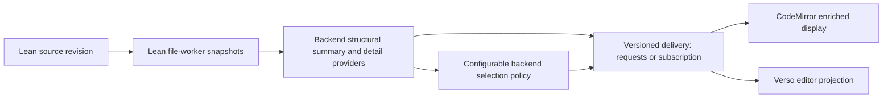

# Enriched display: initial design exploration

Status: interaction proposal, 2026-11-09. The [use cases](enriched-display-use-cases.md)
govern the design. This document records proposals for review, not an implemented
interaction contract. The existing two-pane demo remains an extraction experiment.

The agreed direction is one document component with a progressive shift between
source and enriched presentation, within the source editor. The current priority
is interaction and rendering design. Supplied or mock presentation content is
sufficient; contributions are selected manually. Automatic mathematical
translation, author metadata and more elaborate selection providers are later
work. The [native worker experiment](reviews/2026-11-06-snapshot-display.md)
establishes a structural input without making those later features prerequisites.

## Interaction proposal for review

### Two independent choices

**Presentation** controls how a region is displayed. **Contribution focus**
controls which regions receive emphasis or are collapsed. A user can inspect the
main contributions as ordinary Lean source, or read the entire file with enriched
presentation. Neither control changes the source or chooses mathematical meaning.

Use three named anchors while comparing the interaction: **Source**, **Mixed**,
and **Rendered**. A control may later interpolate between them; an arbitrary
percentage is not a product requirement. Continuous refers first to keeping one
document, location and editing context through the transition. Motion and the
precise control remain design questions.

| Anchor | Documentation | Statements | Proofs and supporting material |
| --- | --- | --- | --- |
| Source | Original comments | Original Lean | Visible unless independently folded |
| Mixed | Rendered beside its source location | Source with a supplied mathematical companion | Existing expansion choices retained |
| Rendered | Rendered at its original position | Supplied presentation replaces the source visually | Proof disclosure; supporting material follows contribution focus |

Source is the initial state for the first interaction trial, with Mixed one
explicit action away. This is a proposed starting point, not a permanent default.
Global presentation changes do not close an active edit or a user-opened proof.
Returning to Source always restores source visibility, while contribution focus
remains a separate, visibly active choice.

### Compare two placements

**In place:** rendered content is introduced immediately above/below its source
region in Mixed, then occupies that region in Rendered. This is the simpler
reference design and adapts naturally to narrow windows. Its cost is vertical
movement while source and presentation coexist.

**Margin to inline:** Mixed places a presentation companion to the right of its
source region, in the same document flow. Moving toward Rendered lets it occupy
the source column. This more directly explores the original right-to-left idea.
Its costs are width, alignment for unequal source/rendered heights, and an
additional narrow-window transition. At narrow widths the companion stacks.

Both preserve declaration order and one document scroll position. Neither has
an independently scrolling reader pane. The design comparison should use the
same file, contribution choices, disclosure controls and editing behavior.
No glyph crossfades or animated typing are required. Layout transitions should
anchor the active declaration (or the top visible declaration when reading),
respect reduced-motion preferences, and finish before resuming normal typing.
The first implementation may use discrete transitions to establish these rules.

### Local reveal and editing

A rendered statement and its documentation expose a labeled **Edit source**
action; proofs have a separate disclosure. The first design does not require an
exact correspondence between a clicked mathematical symbol and a Lean token.
A known source location or the start of the declaration is an honest initial
caret target.

| Action | Proposed behavior |
| --- | --- |
| Edit source | Reveal that region, restore its last valid source selection or choose its start, focus the existing editor |
| Open proof | Reveal the proof in place without changing contribution membership |
| Start typing or composing input | Keep the active source region visible; retain normal Lean feedback and undo |
| Move focus elsewhere | Leave deliberately revealed source open; do not collapse it on blur |
| Return to display | End the local reveal override if a current presentation is available; otherwise retain source with an availability explanation |
| Change the global presentation | Apply to eligible regions while preserving active selections, edits and explicit expansions |
| Search, follow a reference, navigate to a diagnostic | Reveal the destination and necessary enclosing regions, even when contribution focus would hide it |
| Close a region containing the caret/selection | Keep it open or require an explicit focus transfer; never hide the selection silently |

Ordinary clicks select/focus rendered content or activate an explicit control;
hover alone does not switch representation. Keyboard users can reach all reveal
and disclosure controls. In source editing, moving a source caret into a hidden
range should reveal that range before editing; no whole theorem becomes an
accidentally deletable atomic object. Test arrows, Backspace/Delete, multi-range
selection and input composition as dedicated interactions.

Presentation changes stay out of source undo history. Undo of a source edit
reveals its affected region if necessary. Proposed clipboard policy: a document
selection copies underlying Lean source, including folded material; copying a
rendered representation is a separately named action. This policy needs a user
walkthrough, particularly for mixed selections and accessible text selection.

### Selecting the main contributions

A declaration has an explicit **Mark contribution** toggle with a textual state.
Marks produce a consistent gutter/region accent in every presentation state;
color is accompanied by a label or symbol. Marks are local view preferences in
the first design, not new Lean annotations. Later author metadata may supply
defaults, with the same visible selection semantics.

With **Focus contributions** off, the complete document remains available and
marked contributions are emphasized. With it on, contiguous unmarked regions
become small expansion rows at their original positions. Show the available
count and enough labels to orient the reader; never collect all supporting
material into an unrelated group at the end. Namespace/section context and
required assumptions must remain discoverable. The design trial should compare
compact context headers against retaining the original context lines.

Expanding a supporting region does not mark it as a contribution. Active edits,
current selections and navigation targets override collapse temporarily. Incoming
errors add a visible diagnostic indicator to a collapsed group; they do not
unexpectedly expand it or steal focus. Activating the indicator reveals the
relevant source. With no contributions selected, explain the empty focus view
and offer an immediate way to show the full document.

Preserve marks and explicit expansion through unambiguous edits. If identity is
uncertain after a rename, move, or structural change, retain source and make the
lost correspondence visible rather than assigning the preference to a different
declaration. Exact persistence across reloads is not part of this first trial.

### Rendering, availability and feedback

Keep the document visually coherent: code remains monospaced; prose and mathematics
use their appropriate typography. Use one hierarchy of sections and declaration
names rather than unrelated cards. Disclosure rows, contribution accents and
error indicators have consistent positions across presentation states. Large
statements wrap or expose source without making the whole editor overflow.

Presentation provenance and Lean checking are separate. Illustrative or supplied
math in the UI trial is labeled as such and tied to the chosen fixture content.
Typing does not magically regenerate mock mathematics. Where there is no current
presentation, the region remains Lean source; that is a supported state, not an
exception requiring a failed-looking page.

| Availability | Display and interaction |
| --- | --- |
| Current structure and presentation | Eligible for the selected presentation state |
| Edited / pending structure | Keep current source editable; withhold obsolete replacement content |
| Structure ready, presentation missing | Lean statement remains visible, with an unobtrusive source-only indication if needed |
| Checking / error / warning | Show real Lean feedback independently of the presentation's availability |
| Unsupported syntax or failed renderer | Keep the exact source and a local explanation; other regions remain usable |
| Disconnected | Keep the draft and source navigation; indicate unavailable Lean feedback and retire old authoritative displays |

The desired UX is local invalidation with stable reading position. The current
probe only supports conservative whole-summary invalidation. Mock states may
illustrate the desired UX but must not claim this finer-grained correspondence
already exists. Any source fallback must preserve the active cursor anchor; do
not solve stale data by replacing the entire editor or resetting its scroll.

### Design walkthroughs before implementation

Use one small file with documentation, explicit/contextual parameters, two marked
contributions, several helpers, a long proof and one unsupported region. Prepare
static current, pending and error states. The existing native fixture may supply
ranges, but rendering data and contribution choices can be supplied by hand.

1. Move Source → Mixed → Rendered with the same declaration in view. Compare
   In place and Margin to inline, including a narrow window.
2. Mark two contributions, focus them, expand a helper, then change presentation.
   Contributions remain highlighted and the helper remains open.
3. Reveal a theorem to edit, change a hypothesis, and inspect the pending state.
   Focus, source, selection and Lean feedback remain usable.
4. Return to display with missing mock presentation. The edited source stays
   visible rather than displaying unrelated or stale mathematics.
5. Navigate to an error in a collapsed helper, then undo an edit. Reveal the
   affected source while retaining unrelated contribution choices.
6. Walk the same flow with keyboard navigation, selection/copy and reduced motion.

Decisions for this review: placement in Mixed; explicit reveal versus additional
caret-driven reveal rules; how much context stays visible in contribution focus;
and whether three presentation anchors express the intended continuous shift.
Visual spacing and animation should follow these decisions. No editor, backend,
transport or renderer implementation is authorized by this design document alone.

## Information flow

The source remains the editable document. The backend derives compact summaries
from actual worker snapshots. The frontend owns layout, expansion, selection,
and rendering. It never reparses Lean to manufacture authoritative boundaries.

The initial display should add theorem/documentation views and structural
folding to the existing source editor. A source reveal operation provides the
editing path. Rich mathematical editing with automatic TeX-to-Lean conversion
is outside this first design; KaTeX views are read-only projections.

## Backend extraction and its limits

In the locally inspected Lean 4.34.1 sources, a command snapshot exposes syntax,
command state, an environment, and access to elaboration information. These are
inputs for an extractor, not an already-defined theorem/documentation display
API. Establish reliable declaration ownership, ranges, documentation association,
and statement/proof boundaries with a focused backend feasibility experiment.

One command can produce multiple declarations; macros and elaborators can
generate declarations without independent source ranges. Namespace/section
context, implicit parameters, local notation, and generated helpers require
explicit handling. A declaration's global name or an array index alone cannot
serve as stable identity across edits. Preserve unknown cases as source regions.

Do not force incomplete elaboration tasks merely to populate a document outline.
The inspected `Snapshot.infoTree` implementation includes a blocking warning;
the experiment must identify nonblocking access and bounded waits for the data
actually needed. Outline extraction and expensive semantic/detail queries should
have independent readiness and cancellation.

Verso's current backend demonstrates a useful existing path: capture `readDoc`,
walk completed `cmdSnaps` with a bounded cancellable wait, summarize actual
syntax, validate original source, and return explicit partial coverage. Its
`root.children` is a summary rather than a complete editable CST. Its current
block IDs derive from traversal indices and should not be assumed stable across
edits. The local projects pin different Lean releases (4.34.1 and 4.36.0-rc1),
so a common contract must not imply binary or internal-API compatibility.

## Candidate information contract

These are required concepts, not finalized field names:

| Information | Purpose |
| --- | --- |
| Document URI, open-session/server generation, source revision and source equivalence | Reject results for the wrong text, tab, reopened file, or server |
| Summary identity and analysis sequence within that revision | Order partial-to-complete updates for unchanged source |
| Explicit coordinate encoding and original-source ranges | Place displays correctly across CRLF, Unicode and transport normalization |
| Coverage and completion state | Distinguish pending, unsupported, failed and absent structure |
| Region identity, kind, parent/context and source anchors | Navigate declarations, documentation, proofs, sections and fallback regions |
| Independent structure, statement and checking availability | Avoid equating a rendered statement with a successfully checked proof |
| Capability/provider identifiers | Discover supported detail formats and selection policies |
| Policy identity/configuration and selection reasons | Explain and reproduce the chosen summary |
| Bounded detail references tied to a summary revision | Load documentation, mathematical statements or dependencies on expansion |

Use original-source UTF-16 ranges at the editor boundary, consistent with the
existing Verso transport. Bind references to the captured revision and reject
expired ones; never retain worker snapshots indefinitely just to keep UI handles
alive. Details may be unavailable without invalidating the outline.

Request IDs correlate responses. Document revisions establish source identity.
Analysis sequences order successive updates for the same revision. Selection
configuration identifies a view policy. Keep these meanings distinct.

## Pull and broadcast

| Mechanism | Useful property | Requirement |
| --- | --- | --- |
| Pull current summary or region details | Explicit demand, cancellation, lazy expansion; matches the existing Verso approach | A later pull must be possible when analysis advances without a source edit |
| Broadcast/subscribed summaries | Updates follow worker progress naturally | Subscription ownership, bounded queues/coalescing, per-revision update ordering and reconnection |
| Notify availability, then pull | Small notifications with demand-driven materialization | Both an availability signal and a request contract |

Start the feasibility experiment with pull requests over captured snapshots.
Keep delivery independent of the summary data so a subscription or availability
notification can be added after evaluating upstream support. Do not prescribe
method names or send unsolicited whole-document trees on every worker update.
If the first prototype uses refresh polling, keep it bounded and cancellable.
An immutable captured document cannot be polled into becoming a future revision.

On an edit, invalidate affected displays and cancel obsolete work immediately.
A stale response cannot regain authority merely because its ranges can be mapped
through the edit. The simplest initial rule is whole-summary invalidation, with
source fallback until matching information returns. Later incremental reuse
requires a demonstrated correspondence contract.

## Configurable backend summarization

Selection runs against the structural summary and optional semantic information.
It does not require replaying elaboration. Advertised policy providers accept
validated configuration scoped to a request or reader session, with optional
project defaults. They must not mutate global selection settings shared by tabs.

Initial policy families are annotations/pins, structural filters, and dependency
or relevance selection. Each policy reports its identity, effective configuration,
selection reasons, and unavailable inputs. Unsupported options fail explicitly.
Dependency policies specify whether they inspect statements, proofs, or another
relation; deterministic selection should be reproducible from the same inputs.

Return enough structure or expansion handles to discover omitted material.
Backend-selected core nodes and reader expansion are separate state. Expanding
a helper does not promote it to core; pinning it may change the next policy
request. An error or search result can temporarily reveal a hidden region.
Selection failures leave source and available structure usable.

## Mathematical statements and documentation

KaTeX renders supplied TeX. Producing faithful TeX from Lean requires a separate
provider with an explicit supported subset and presentation policy. Start from
snapshot-associated syntax and elaborated declaration data, evaluate which
representation preserves user notation and binder context, and retain a Lean
text fallback. Do not translate by regular-expression substitutions over source.
Neither syntax nor a bare elaborated expression alone solves all presentation
questions; custom notation and implicit/contextual arguments need experiments.

A detail response should identify its declaration, source revision, format,
provider, and availability. KaTeX input is presentation data, not new proof
authority. Keep full Lean text accessible alongside any elided formal detail.
Unsupported constructs, pending elaboration, and render errors have distinct
fallbacks. The rendered statement never conceals an incomplete proof status.

Documentation needs a format-aware provider and source anchors. Render the
supported Lean documentation format or structured Verso content through the
appropriate frontend adapter. Preserve project-specific roles and directives
as explicit fallback when no renderer is available.

Use the host's content-safety boundary for documentation and KaTeX options:
restrict trusted commands, bound expansion, keep unrelated documents' macro
state separate, and display renderer errors as text. KaTeX's
[API](https://katex.org/docs/api) documents TeX input and macro state; its
[security guidance](https://katex.org/docs/security) describes the relevant
limits and trust options.

## Frontend projection and identity

Keep source in the existing CodeMirror document. Implement displays and folds
as view state derived from accepted summaries; expansion preferences are separate
from document edits and undo. Source reveal, keyboard navigation, search and
diagnostic navigation must open the relevant regions. No current selection may
be hidden by a newly applied summary. Measure decoration/widget churn and scroll
stability before choosing fine-grained incremental updates.

Use revision-local region identities first. Restoring expansion across revisions
requires conservative correspondence using declaration identity and enclosing
context, with source anchors where valid. Deletion, renaming, duplicate/local
names and macro-generated declarations can make correspondence ambiguous; reset
the affected view preference rather than attaching it to unrelated content.

## Shared boundary with verso-mirror

Potential shared concepts are source identity, ranges, coverage, update ordering,
capability negotiation, detail lifetime and selection configuration. Lean
declaration payloads and Verso block payloads retain their own schemas. Neither
the generic shell package nor either frontend should import Lean worker internals.

Use the current Verso implementation as evidence, then exercise a declaration
consumer and a Verso consumer before extracting a package. Schema versioning and
capability negotiation must account for independent toolchain pins. Migrating
Verso's existing endpoint, broadcasting structure, or moving diagnostics to the
normal LSP channel are separate coordinated changes.

## Design sequence and upstream discussion

1. Review the interaction proposal and static alternatives above; settle placement,
   source reveal, contribution focus, and pending/error behavior.
2. Once agreed, implement one UI slice within the existing CodeMirror editor using
   supplied presentation data and manual contribution marks. Preserve ordinary
   Lean feedback and validate the editing walkthroughs.
3. Use the resulting UI requirements to refine declaration detail queries,
   provenance, snapshot coverage and the minimal Lean/Verso information envelope.
4. Add real mathematical presentation providers and author metadata incrementally.
   A general Lean-to-TeX translator is not a prerequisite for steps 1 and 2.

For Marc and the Lean/Verso maintainers, discuss a supported snapshot-summary
surface, progress/invalidation notifications, access to declaration/documentation
metadata, and versioning/lifetime guarantees. Infoview disposal remains useful
parallel integration work; enriched display does not require a new VS Code host
or wait for the infoview ownership API to begin its design.

## Evidence used for this proposal

- The checked-in `lean-toolchain` and installed Lean 4.34.1 sources:
  `Lean/Server/Snapshots.lean` and `Lean/Server/Requests.lean`.
- The sibling checkout's `Bridge/WorkerStructure.lean`, `Bridge/Protocol.lean`,
  and `docs/LSP.md`, including its distinct 4.36.0-rc1 toolchain pin.
- The KaTeX API and security documentation linked above.

These establish available building blocks and existing contracts. The proposed
declaration extractor, mathematical provider and common wire envelope still
require the experiments described here.
