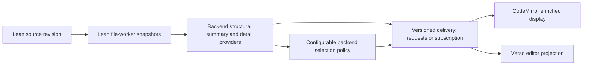

# Enriched display: initial design exploration

Status: reviewed interaction proposal, 2026-11-09. The [use cases](enriched-display-use-cases.md)
govern the design. This document records proposals for review, not an implemented
interaction contract. This revision incorporates the review of `ab088042`: in-place
layout is selected for the first slice, with the selection, mutation and focus
contracts below as acceptance gates. The two-pane demo remains an extraction experiment.

The agreed direction is one document component with a progressive shift between
source and enriched presentation, within the source editor. The current priority
is interaction and rendering design. Supplied or mock presentation content is
sufficient; contributions are selected manually. Automatic mathematical
translation, author metadata and more elaborate selection providers are later
work. The [native worker experiment](reviews/2026-11-06-snapshot-display.md)
establishes a structural input without making those later features prerequisites.

## Interaction proposal for review

### Two independent choices

**Presentation** controls how a region is displayed. **Contribution focus**
controls which regions receive emphasis or are collapsed. A user can inspect the
main contributions as ordinary Lean source, or read the entire file with enriched
presentation. Neither control changes the source or chooses mathematical meaning.

Use a three-way control: **Source**, **Mixed**, and **Rendered**. It describes
**requested presentation**; individual regions can remain source because they
are being edited, lack a current presentation, or have unsupported structure.
Show a local reason such as “Editing” or “Presentation unavailable” so the global
control does not appear broken. A continuous slider can be explored later.
Continuity initially means preserving one document, location and editing context.

| Anchor | Documentation | Statements | Proofs and supporting material |
| --- | --- | --- | --- |
| Source | Original comments | Original Lean | Visible unless independently folded |
| Mixed | Rendered immediately below its source | Source with a mathematical companion immediately below it | Existing expansion choices retained |
| Rendered | Rendered at its original position | Supplied presentation replaces the source visually | Proof disclosure; supporting material follows contribution focus |

Source is the initial state for the first interaction trial, with Mixed one
explicit action away. This is a proposed starting point, not a permanent default.
Global presentation changes do not close an active edit or a user-opened proof.
Returning to Source restores source representation; contribution focus and user
folds continue to control visibility as separate, visibly active choices.

### Placement selected for the first slice

**In place:** Mixed places the rendered companion immediately below its source
region consistently throughout the file; Rendered occupies that region visually.
Both retain source order, a single document scroll position, and a narrow-window
baseline. Vertical movement must preserve the active declaration's screen anchor
(or the top visible declaration when reading).

**Margin to inline is deferred pending a real-editor feasibility experiment.**
Its costs include unequal heights, width and wrapping, and cursor geometry.
In an [upstream block-wrapper discussion](https://discuss.codemirror.net/t/support-blockwrappers-altering-layout/9652),
the maintainer states that lines and block widgets must remain vertically
arranged. A flex/grid wrapper containing actual source lines and a companion is
therefore not an established route. A visual sketch cannot establish feasibility;
this does not rule out every possible margin implementation. Any later experiment
must check unequal source/rendered heights, wrapping, click-to-caret placement,
keyboard movement, resizing and narrow-window stacking before adoption.

The first slice can switch layout discretely. Any later motion respects reduced
motion and never delays or drops input. Typing snaps a transition to its final
layout, or defers it until editing/composition permits it. Never queue keystrokes
behind animation or replace an active composition node to finish a transition.

### Local reveal and editing

A rendered statement and its documentation expose a labeled **Edit source**
action; proofs have a separate disclosure. There is no mathematical-symbol to
Lean-token correspondence in the first slice. A known source location or the
start of the selectable source region is the initial caret target.

| Action | Required behavior for the trial |
| --- | --- |
| Edit source | Reveal the region, restore its valid remembered source selections or choose its start, and focus the existing editor |
| Open proof | Reveal the proof in place without changing contribution membership |
| Start typing or composing input | Keep the complete active source selections visible; preserve Lean feedback, input events and undo |
| Move focus elsewhere | Leave deliberately revealed source open; do not collapse it on blur |
| Return to display | Perform the explicit focus handoff below when presentation is current; otherwise retain source and explain why |
| Change requested presentation | Preserve active selections, edits and explicit expansions; show local source exceptions |
| Search, follow a reference, navigate to a diagnostic | Reveal the destination and enclosing regions before focusing source |
| Select across hidden source / Select All | Reveal the entire selected intervals, for all source selections, before subsequent editing |
| Backspace/Delete into hidden source | Reveal the affected regions and consume the first action without deleting anything |
| Cut, paste, typing or another replacement still reaching hidden source | Reveal all affected ranges and consume the action without mutation or clipboard change; require a new editing action |
| Close a region intersecting an active source selection | Keep it open until the selection is moved or an explicit focus handoff completes |

#### Source selection and mutation contract

Protection covers the **whole interval of every active source selection**, not
just endpoints or the primary cursor. Empty selections protect their caret;
nonempty selections reveal every intersected hidden region. Newly applied
presentation/focus changes may not rehide those intervals. Select All in the
source editor reveals the full selected document. This stronger trial rule also
applies to source selections made for Copy; no copy-only hidden-selection mode
is needed initially.

Selection visibility alone is not a sufficient mutation guard. Before a local
editing command commits changes, inspect its complete intended source footprint,
including changes expanded by deletion semantics and all secondary selections.
Use visibility before the command; expanding decorations in the same transaction
as a deletion does not count as prior disclosure. If any change would reach hidden
text, reveal the affected regions and consume that entire invocation. Do not partially mutate the other cursors, enqueue a
replay, alter the clipboard for Cut, or create a source undo entry. A subsequent
intentional action operates normally on visible source. Boundary Backspace/Delete
uses the same rule; suppress the held key's auto-repeat until key release so a
reveal-only action cannot immediately become an unseen deletion.

This applies to keyboard, menu and native input paths (including cut, paste,
replacement typing and drag/drop), not just a particular keymap. Composition
starts with its target already revealed; if that cannot be established safely,
keep that region in source rather than taking ownership of or discarding IME
input. Undo/redo and explicit workspace/code-action edits reveal their affected
regions before applying the authorized edit without introducing a second source
history. This design does not add confirmation prompts to those operations.

The installed CodeMirror commands and the
[upstream deletion implementation](https://github.com/codemirror/commands/blob/main/src/commands.ts#L519-L555)
construct changes from selections and may expand endpoints through atomic ranges.
Consequently, cursor-motion hooks or `atomicRanges` alone cannot enforce this
contract. Do not make a rendered theorem an atomic deletion unit. The eventual
implementation must exercise the actual input/clipboard paths; this is a design
requirement, not a claim that those guards exist today.

#### Rendered selection and clipboard contract

Use **whole-statement region selection** for rendered mathematics, visibly marked
and labeled “Lean statement selected”. This is view selection, distinct from
CodeMirror's active source-text selection. A pointer click or accessible region
selection control selects the region; it does not enter source editing. Clipboard
commands use the focused selection owner. Entering source clears the rendered
selection, and a remembered bookmark never controls Copy. Arbitrary
substring selection inside rendered mathematics and mixed source/widget text
selection are deferred. Dragging over `a + b` must not show a partial native text
selection that then silently copies a larger source range. Offer Edit source for
exact source-text selection. Hover never changes representation.

A statement region must have an exact source range covering its declaration
modifiers/keyword, name, binders and type, excluding documentation, the value/proof
separator and proof. The same scope is used by default Copy for that selected
rendered region and by the explicit **Copy Lean statement** action. Do not silently
fall back to copying the whole declaration. When that exact range is unavailable,
leave the statement as source and omit/disable the scoped rendered-copy action.
The UI trial may use explicitly supplied fixture ranges; the flattened snapshot
regions alone are not a general ownership/mapping contract.

**Copy rendered mathematics** is a separate action for the complete supplied
mathematical representation, including its displayed binder context. It uses
provider-supplied clipboard text, not incidental renderer DOM text. No automatic
TeX-to-Lean or substring mapping is implied. Source selections copy exactly their
selected Lean ranges with normal editor multiple-selection semantics. Material
previously folded is included because source selection already revealed it.
Rendered-region Copy can preserve the rendered view because it does not mutate
source and its whole-region scope is visible. Cut/Delete/paste on a rendered
selection reveal the source region and transfer the equivalent source selection
without mutating it; the next intentional editing action operates on that source.

#### Successful Return to display handoff

Keep three concepts separate: a remembered source bookmark, active source
selection(s), and keyboard focus ownership. When presentation is current:

1. Remember every selection contained in the local edit region, including direction,
   primary range and revision. If a selection crosses its boundary or another
   active cursor lies elsewhere, leave it open and explain that the source
   selection must first be narrowed; never silently discard the extra ranges.
2. Transfer focus to the persistent declaration header's **Edit source** control.
   End source-editing selection ownership and clear its active highlight. The
   editor may retain a parked, collapsed boundary position, but it is not an
   active hidden selection or the saved bookmark.
3. Apply the rendered presentation and mark the whole statement as the view's
   selected region. The focused control must survive the decoration change.
4. On Edit source, reveal first, restore the valid bookmark, then focus the editor.
   Map bookmarks only through known changes; if correspondence is uncertain,
   reveal source and choose the region's start rather than a stale location.

Check availability and the selection preconditions before beginning the handoff.
If presentation is absent or stale, keep the source edit state and selection.
Ordinary printable typing while the rendered control has focus does not insert,
replace, or implicitly enter source. Enter/Space activates its Edit source action;
normal navigation and accessibility commands remain available. Any later source
focus must satisfy selection visibility before editing begins.

Presentation changes stay out of source undo history. This explicit handoff is
also how a user closes an edit with a caret still inside it; normal blur never
performs that closure.

### Selecting the main contributions

A declaration has an explicit **Mark contribution** toggle with a textual state.
Marks produce a consistent gutter/region accent in every presentation state;
color is accompanied by a label or symbol. Marks are local view preferences in
the first design, not new Lean annotations. Later author metadata may supply
defaults, with the same visible selection semantics.

With **Focus contributions** off, the complete document remains available and
marked contributions are emphasized. With it on, contiguous unmarked regions
become small expansion rows at their original positions. Show the available
count and enough labels to orient the reader; never collect all supporting
material into an unrelated group at the end. Namespace/section context and
required assumptions remain available in the original source lines initially.
Keep a visible namespace/section scaffold and retain scope declarations such as
variables, assumptions, notation and opens. If the backend cannot establish which
context is relevant, retain the enclosing context conservatively. Compact derived
context headers are later work, not a prerequisite for contribution focus.

Expanding a supporting region does not mark it as a contribution. Active edits,
current selections and navigation targets override collapse temporarily. Incoming
errors add a visible diagnostic indicator to a collapsed group; they do not
unexpectedly expand it or steal focus. Activating the indicator reveals the
relevant source. With no contributions selected, explain the empty focus view
and offer an immediate way to show the full document.

Preserve marks and explicit expansion through unambiguous edits. If identity is
uncertain after a rename, move, or structural change, retain source and make the
lost correspondence visible rather than assigning the preference to a different
declaration. Exact persistence across reloads is not part of this first trial.

### Rendering, availability and feedback

Keep the document visually coherent: code remains monospaced; prose and mathematics
use their appropriate typography. Use one hierarchy of sections and declaration
names rather than unrelated cards. Disclosure rows, contribution accents and
error indicators have consistent positions across presentation states. Large
statements wrap or expose source without making the whole editor overflow.

Presentation provenance and Lean checking are separate. Illustrative or supplied
math in the UI trial is labeled as such and tied to the chosen fixture content.
Typing does not magically regenerate mock mathematics. Where there is no current
presentation, the region remains Lean source; that is a supported state, not an
exception requiring a failed-looking page.

| Availability | Display and interaction |
| --- | --- |
| Current structure and presentation | Eligible for the selected presentation state |
| Edited / pending structure | Keep current source editable; withhold obsolete replacement content |
| Structure ready, presentation missing | Lean statement remains visible, with an unobtrusive source-only indication if needed |
| Checking / error / warning | Show real Lean feedback independently of the presentation's availability |
| Unsupported syntax or failed renderer | Keep the exact source and a local explanation; other regions remain usable |
| Disconnected | Keep the draft and source navigation; indicate unavailable Lean feedback and retire old authoritative displays |

The desired UX is local invalidation with stable reading position. The current
probe only supports conservative whole-summary invalidation. Mock states may
illustrate the desired UX but must not claim this finer-grained correspondence
already exists. Any source fallback must preserve the active cursor anchor; do
not solve stale data by replacing the entire editor or resetting its scroll.

### Acceptance walkthroughs for the first live-editor slice

Use a small file with documented contributions, helpers between contributions,
contextual parameters, a long proof, unsupported syntax and an incomplete/admitted
proof. Supply presentation data and contribution marks by hand where needed.
These are required observations for the subsequent implementation, not completed
tests of this documentation revision.

| Case | Required observation |
| --- | --- |
| Source → Mixed → Rendered in place, including a narrow window | Stable declaration anchor and source order; local editing/missing-data exceptions visibly explain requested versus actual presentation |
| Mark contributions, focus them, expand a helper, change presentation | Membership, highlights and explicit expansion remain independent |
| Select A through a collapsed helper to B; repeat via Select All and secondary ranges | All selected intervals reveal, including the helper even though neither endpoint is inside it |
| Cut, Delete, replacement typing and paste across that selection | The complete scope is visible before mutation; if any hidden range remains, the first invocation only reveals and leaves source/clipboard unchanged |
| Backspace/Delete at either replacement boundary, including a held key | First action only reveals; repeat cannot cause automatic deletion; a new intentional action edits normally |
| One of several cursors reaches hidden source | The first protected command has no partial mutations at any other cursor |
| Select rendered mathematics, try dragging over `a + b`, then Copy | Whole statement selected visibly; default/Copy Lean statement copies only its exact statement range; Copy rendered mathematics copies its supplied presentation; no false substring selection |
| Return to display with current data and a caret inside source | Focus lands on the persistent Edit source control; no active selection is hidden; reopening restores the bookmark |
| Return with a cross-region or external secondary selection | Source stays open and the selection-scope reason is visible |
| Return with missing/stale presentation | Edited source and active selection remain available |
| Navigate to an error in a collapsed helper; undo/redo a source edit | Affected source reveals; unrelated marks remain; presentation changes do not pollute source undo |
| Start input or IME composition during a presentation transition | Input is never delayed, replayed or dropped for animation; composition retains its editable target |
| Change earlier notation `local notation "𝓝" => Nat` to `Int`, or change a section parameter | An unchanged later theorem invalidates its mathematical presentation; contribution marks may survive independently |
| Open actual CRLF/non-BMP source in CodeMirror, render and reveal regions, then edit/undo before them | Ranges index the captured editor string exactly; native substring tests alone do not satisfy this case |
| Screen-reader walkthrough of Mixed and Rendered, including a collapsed admitted/incomplete proof | Coherent reading order, labeled representations and controls, and separately announced proof/checking status; no duplicate math from renderer internals |

In Mixed, label source and rendered representations distinctly and expose one
accessible mathematical description rather than multiple renderer copies.
In Rendered, hidden source must not be read a second time. Disclosure controls
expose their expanded state; proof status comes from Lean when available, or is
explicitly unavailable. A successful mathematical renderer never implies a
checked proof. Verify this with an actual screen reader as well as keyboard use.

The first-slice decisions are in-place placement, explicit Edit source with
protected automatic reveal, retained original context lines, and a three-way
requested-presentation control. Margin geometry, fine-grained math selection,
compact context synthesis and animated interpolation remain separate follow-ups.
The current change is documentation only; real-editor acceptance remains ahead.

## Information flow

The source remains the editable document. The backend derives compact summaries
from actual worker snapshots. The frontend owns layout, expansion, selection,
and rendering. It never reparses Lean to manufacture authoritative boundaries.

The initial display should add theorem/documentation views and structural
folding to the existing source editor. A source reveal operation provides the
editing path. Rich mathematical editing with automatic TeX-to-Lean conversion
is outside this first design; KaTeX views are read-only projections.

## Backend extraction and its limits

In the locally inspected Lean 4.34.1 sources, a command snapshot exposes syntax,
command state, an environment, and access to elaboration information. These are
inputs for an extractor, not an already-defined theorem/documentation display
API. Establish reliable declaration ownership, ranges, documentation association,
and statement/proof boundaries with a focused backend feasibility experiment.

One command can produce multiple declarations; macros and elaborators can
generate declarations without independent source ranges. Namespace/section
context, implicit parameters, local notation, and generated helpers require
explicit handling. A declaration's global name or an array index alone cannot
serve as stable identity across edits. Preserve unknown cases as source regions.

Do not force incomplete elaboration tasks merely to populate a document outline.
The inspected `Snapshot.infoTree` implementation includes a blocking warning;
the experiment must identify nonblocking access and bounded waits for the data
actually needed. Outline extraction and expensive semantic/detail queries should
have independent readiness and cancellation.

Verso's current backend demonstrates a useful existing path: capture `readDoc`,
walk completed `cmdSnaps` with a bounded cancellable wait, summarize actual
syntax, validate original source, and return explicit partial coverage. Its
`root.children` is a summary rather than a complete editable CST. Its current
block IDs derive from traversal indices and should not be assumed stable across
edits. The local projects pin different Lean releases (4.34.1 and 4.36.0-rc1),
so a common contract must not imply binary or internal-API compatibility.

## Candidate information contract

These are required concepts, not finalized field names:

| Information | Purpose |
| --- | --- |
| Document URI, open-session/server generation, source revision and source equivalence | Reject results for the wrong text, tab, reopened file, or server |
| Summary identity and analysis sequence within that revision | Order partial-to-complete updates for unchanged source |
| Explicit coordinate encoding and original-source ranges | Place displays correctly across CRLF, Unicode and transport normalization |
| Coverage and completion state | Distinguish pending, unsupported, failed and absent structure |
| Region identity, kind, parent/context and source anchors | Navigate declarations, documentation, proofs, sections and fallback regions |
| Independent structure, statement and checking availability | Avoid equating a rendered statement with a successfully checked proof |
| Capability/provider identifiers | Discover supported detail formats and selection policies |
| Policy identity/configuration and selection reasons | Explain and reproduce the chosen summary |
| Bounded detail references tied to a summary revision | Load documentation, mathematical statements or dependencies on expansion |

Ranges are half-open UTF-16 code-unit offsets into the **exact captured source
string associated with the request**, not an unspecified original file. The
CodeMirror adapter captures its editor document and sends
`editor.state.doc.toString()` with the corresponding synchronized revision. The
returned offsets index that LF-based string directly. Persisted CRLF text or a
differently normalized string requires an explicit mapping before reuse.
For example, `b` starts at offset 3 in `a\r\nb` but offset 2 in `a\nb`.
Non-BMP characters still occupy two UTF-16 code units in either string.

The native probe accepts caller-supplied text and maps from Lean's canonical text
back to that exact string; its CRLF support does not make those offsets directly
usable in a normalized editor document. Source equivalence, coordinate basis and
revision validity are distinct checks. This clarifies the existing browser
experiment's choice, not a demonstrated defect in it. Verso's adapter must likewise
name its exact captured string; sharing an encoding alone is insufficient.

Bind references to the captured revision and reject expired ones; never retain
worker snapshots indefinitely just to keep UI handles alive. Details may be
unavailable without invalidating the outline.

Request IDs correlate responses. Document revisions establish source identity.
Analysis sequences order successive updates for the same revision. Selection
configuration identifies a view policy. Keep these meanings distinct.

## Pull and broadcast

| Mechanism | Useful property | Requirement |
| --- | --- | --- |
| Pull current summary or region details | Explicit demand, cancellation, lazy expansion; matches the existing Verso approach | A later pull must be possible when analysis advances without a source edit |
| Broadcast/subscribed summaries | Updates follow worker progress naturally | Subscription ownership, bounded queues/coalescing, per-revision update ordering and reconnection |
| Notify availability, then pull | Small notifications with demand-driven materialization | Both an availability signal and a request contract |

Start the feasibility experiment with pull requests over captured snapshots.
Keep delivery independent of the summary data so a subscription or availability
notification can be added after evaluating upstream support. Do not prescribe
method names or send unsolicited whole-document trees on every worker update.
If the first prototype uses refresh polling, keep it bounded and cancellable.
An immutable captured document cannot be polled into becoming a future revision.

On an edit, invalidate affected displays and cancel obsolete work immediately.
A stale response cannot regain authority merely because its ranges can be mapped
through the edit. The simplest initial rule is whole-summary invalidation, with
source fallback until matching information returns. Later incremental reuse
requires a demonstrated correspondence contract. Equality of a declaration's own
text or identity does not establish semantic freshness: preceding notation,
section variables, imports or options can change its interpretation. In particular,
changing `𝓝` from `Nat` to `Int` invalidates a later unchanged theorem's previous
natural-number presentation. Preserving a contribution mark/bookmark and reusing
mathematical output are independent decisions; only the latter requires current
semantic-context evidence.

## Configurable backend summarization

Selection runs against the structural summary and optional semantic information.
It does not require replaying elaboration. Advertised policy providers accept
validated configuration scoped to a request or reader session, with optional
project defaults. They must not mutate global selection settings shared by tabs.

Initial policy families are annotations/pins, structural filters, and dependency
or relevance selection. Each policy reports its identity, effective configuration,
selection reasons, and unavailable inputs. Unsupported options fail explicitly.
Dependency policies specify whether they inspect statements, proofs, or another
relation; deterministic selection should be reproducible from the same inputs.

Return enough structure or expansion handles to discover omitted material.
Backend-selected core nodes and reader expansion are separate state. Expanding
a helper does not promote it to core; pinning it may change the next policy
request. An error or search result can temporarily reveal a hidden region.
Selection failures leave source and available structure usable.

## Mathematical statements and documentation

KaTeX renders supplied TeX. Producing faithful TeX from Lean requires a separate
provider with an explicit supported subset and presentation policy. Start from
snapshot-associated syntax and elaborated declaration data, evaluate which
representation preserves user notation and binder context, and retain a Lean
text fallback. Do not translate by regular-expression substitutions over source.
Neither syntax nor a bare elaborated expression alone solves all presentation
questions; custom notation and implicit/contextual arguments need experiments.

A detail response should identify its declaration, source revision, format,
provider, and availability. KaTeX input is presentation data, not new proof
authority. Keep full Lean text accessible alongside any elided formal detail.
Unsupported constructs, pending elaboration, and render errors have distinct
fallbacks. The rendered statement never conceals an incomplete proof status.

Documentation needs a format-aware provider and source anchors. Render the
supported Lean documentation format or structured Verso content through the
appropriate frontend adapter. Preserve project-specific roles and directives
as explicit fallback when no renderer is available.

Use the host's content-safety boundary for documentation and KaTeX options:
restrict trusted commands, bound expansion, keep unrelated documents' macro
state separate, and display renderer errors as text. KaTeX's
[API](https://katex.org/docs/api) documents TeX input and macro state; its
[security guidance](https://katex.org/docs/security) describes the relevant
limits and trust options.

## Frontend projection and identity

Keep source in the existing CodeMirror document. Implement displays and folds
as view state derived from accepted summaries; expansion preferences are separate
from document edits and undo. Source reveal, keyboard navigation, search and
diagnostic navigation must open the relevant regions. Protection covers every
interval in every active source selection, including Select All and secondary
ranges, plus the intended mutation footprint. Apply the selection/mutation and
explicit focus-handoff contracts above; retained source bookmarks and rendered
region selections are not active hidden source selections. Measure decoration/widget
churn and scroll stability before choosing fine-grained incremental updates.

Use revision-local region identities first. Restoring expansion across revisions
requires conservative correspondence using declaration identity and enclosing
context, with source anchors where valid. Deletion, renaming, duplicate/local
names and macro-generated declarations can make correspondence ambiguous; reset
the affected view preference rather than attaching it to unrelated content.

## Shared boundary with verso-mirror

Potential shared concepts are source identity, ranges, coverage, update ordering,
capability negotiation, detail lifetime and selection configuration. Lean
declaration payloads and Verso block payloads retain their own schemas. Neither
the generic shell package nor either frontend should import Lean worker internals.

Use the current Verso implementation as evidence, then exercise a declaration
consumer and a Verso consumer before extracting a package. Schema versioning and
capability negotiation must account for independent toolchain pins. Migrating
Verso's existing endpoint, broadcasting structure, or moving diagnostics to the
normal LSP channel are separate coordinated changes.

## Design sequence and upstream discussion

1. Use the reviewed in-place, selection/mutation, clipboard and focus contracts
   above as the baseline. Static alternatives are illustrative, not cursor/input
   feasibility evidence.
2. Implement the next UI slice within the existing CodeMirror editor using
   supplied presentation data and manual contribution marks. Preserve ordinary
   Lean feedback and validate the editing walkthroughs.
3. Use the resulting UI requirements to refine declaration detail queries,
   provenance, snapshot coverage and the minimal Lean/Verso information envelope.
4. Add real mathematical presentation providers and author metadata incrementally.
   A general Lean-to-TeX translator is not a prerequisite for steps 1 and 2.

For Marc and the Lean/Verso maintainers, discuss a supported snapshot-summary
surface, progress/invalidation notifications, access to declaration/documentation
metadata, and versioning/lifetime guarantees. Infoview disposal remains useful
parallel integration work; enriched display does not require a new VS Code host
or wait for the infoview ownership API to begin its design.

## Evidence used for this proposal

- The checked-in `lean-toolchain` and installed Lean 4.34.1 sources:
  `Lean/Server/Snapshots.lean` and `Lean/Server/Requests.lean`.
- The sibling checkout's `Bridge/WorkerStructure.lean`, `Bridge/Protocol.lean`,
  and `docs/LSP.md`, including its distinct 4.36.0-rc1 toolchain pin.
- The KaTeX API and security documentation linked above.

These establish available building blocks and existing contracts. The proposed
declaration extractor, mathematical provider and common wire envelope still
require the experiments described here.
